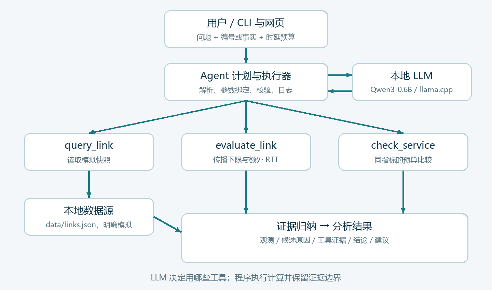
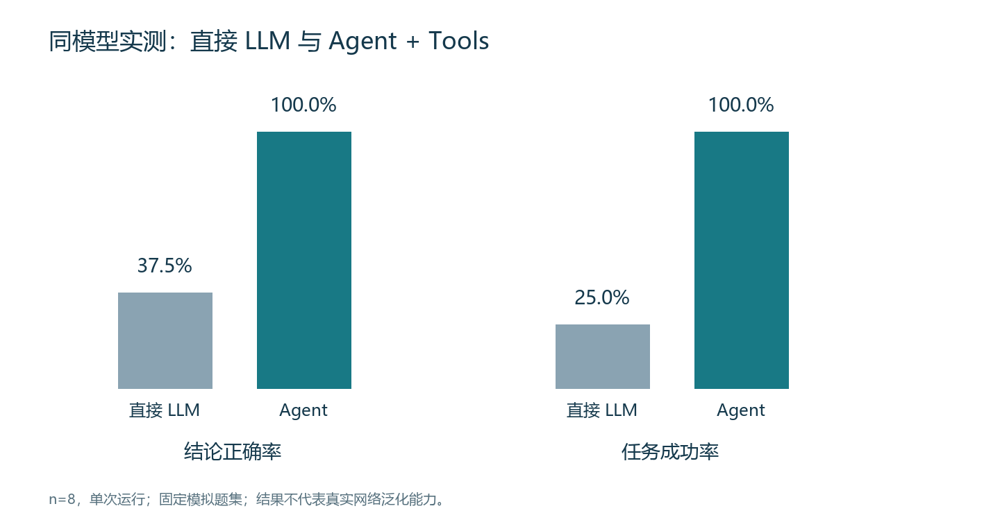

# FiberScope · 光纤链路时延诊断助手

项目仓库：[chenpei6026/fiber-delay-agent](https://github.com/chenpei6026/fiber-delay-agent)

《人工智能的网络应用》课程综合项目。陈佩 **23231203**、赵浩然 **23211256**，职责各 **50%**。

延续课堂“通信链路质量分析与光纤时延评估”方向，实现单 Agent 的真实工具选择、数值计算、证据归纳与异常处理。数据均为本地模拟快照，不访问真实网络设备。

## 功能与架构

- `query_link`：查询模拟链路长度、RTT、利用率、丢包和来源。
- `evaluate_link`：计算 `t = L*n/c` 单程传播时延与对称 RTT 下限，检查矛盾测量。
- `check_service`：只比较同种时延指标的用户预算；阈值是项目策略，不是通用语音标准。
- Qwen3-0.6B-Q8_0 负责意图与工具选择；程序执行工具并生成可审计结论。不是固定调用全部工具，也不是让模型心算。
- Web 页面和 CLI，八个 Case，单元测试、原始工具日志、同模型 A/B 实验。

没有使用 PydanticAI/CrewAI 运行时：使用 Python 标准库实现受约束 JSON 计划 Agent。课程允许其他适当方法。LLM 选择工具后，执行器把显式请求字段和查询结果绑定到参数；最终证据解释使用规则，避免小模型改写计算。这是系统整体比较，不能把所有改进都归因于模型推理能力。

## 环境与安装

Python 3.10+；程序本体不需要 pip 依赖。模型由 [llama.cpp](https://github.com/ggml-org/llama.cpp/releases) 本地服务提供，无需 Ollama。模型：[Qwen3-0.6B 官方 GGUF](https://huggingface.co/Qwen/Qwen3-0.6B-GGUF)，Q8_0 文件约640MB。模型和推理二进制不随 Git/作业ZIP上传，请从官方来源下载。

解压对应系统的 llama.cpp 包，在一个终端启动模型（Windows PowerShell 示例）：

```powershell
.\llama-server.exe -m .\Qwen3-0.6B-Q8_0.gguf --host 127.0.0.1 --port 8081 -c 4096 -t 4 --jinja --alias Qwen3-0.6B-Q8_0
```

另一个终端进入本项目根目录：

```powershell
$env:MODEL_BASE_URL = 'http://127.0.0.1:8081/v1'
$env:MODEL_NAME = 'Qwen3-0.6B-Q8_0'
python -m src.web
```

浏览器打开 http://127.0.0.1:8765 ，选择场景并开始诊断。使用 Qwen3 关闭思考模式、temperature=0、seed=42。默认无 API Key。若改用受认证的兼容接口，将 `MODEL_API_KEY` 设为环境变量，禁止提交真实密钥。`.env.example` 仅提供字段示例，程序不会自动读取 `.env`。

本次工作目录的模型位于项目上一级 `.runtime` 中，已准备好时可用 `scripts/start-local.ps1` 启动。

## CLI 与测试

```powershell
python -m src.main --case C2 --mode llm --output results/demo.json
python -m src.main --case C7 --mode offline
python -m unittest discover -s tests -v
python scripts/evaluate.py --mode llm
```

`offline` 是明确标记的规则演示，不调用 LLM，不计入模型对照实验。原始输入与预期规则在 `tests/cases.json`；实际结果在 `results/evaluation.json`、CSV，离线结果独立保存为 `offline.json`。

自定义输入：把下例保存为 `request.json`，执行 `python -m src.main --request request.json`。

```json
{"question":"请诊断这条链路的高延迟", "facts":{"length_km":1000,"refractive_index":1.468,"rtt_ms":80,"utilization_pct":94,"loss_pct":1.8},"budget_ms":30,"metric":"rtt"}
```

提供 `link_id` 时查询工具取本地记录，`facts` 中显式输入覆盖记录，二者都保留在运行日志。新问题请同时修改事实与预算，不能只改文字沿用无关测量。metric 仅支持 `rtt`、`one_way`。

## 评测口径

同一模型、相同原始测量、同一裁决规则。A直接模型不调用工具，B模型规划后执行工具。A预先得到B查询出的相同快照，但没有计算答案。结论正确率=正确标签/全部Case；数值正确率=误差不超过0.01ms的有效计算题/计算题；工具正确率=有序工具集合与预期一致的Case/全部Case；任务成功要求标签正确、适用的数值正确，且B工具选择正确。单次运行、八个模拟Case，不作统计显著性或真实网络泛化主张。

## 材料

- `report.pdf`：六部分课程报告。
- `docs/architecture.png`、`docs/screenshots/`：架构和实际运行截图。
- `docs/project-introduction.md`、`frontend-design.md`：设计文档与均分职责。
- `docs/coursework-evidence.md`：本组课堂记录摘录及 AI 辅助说明。
- `docs/defense-notes.md`：复现与答辩知识点。

## 本次正式实验

|指标|直接 LLM|Agent + Tools|
|---|---:|---:|
|结论正确率|3/8（37.5%）|8/8（100%）|
|任务成功率|2/8（25%）|8/8（100%）|
|传播计算正确率|0/5|5/5|
|工具选择正确率|不适用|8/8|
|平均耗时|2.880秒|1.874秒|

初版提示词B组任务成功0/8，日志保留于 `results/pilot-v1.*`；精简规划提示词并添加工具示例后得到上表。改进基于同一开发题集，**不属于独立盲测**。正式结果未筛除失败，也不将离线演示计入模型实验。





## 已知限制

单快照不证明故障根因；额外RTT不等同于排队。群折射率、实际光路长度和正反向路径假设影响下限。仅有RTT不能证明单程业务达标。0.6B模型可能错选工具，因此计划、错误和所有失败均记录。输入数值由结构化字段提供，不承诺从任意长文本自动抽取全部参数。Web服务仅绑定本机、无认证，不直接部署公网。
